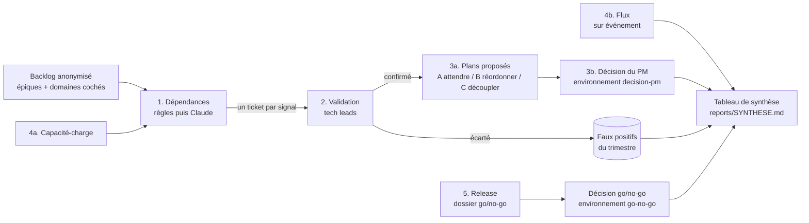

# Simulacre : planification du trimestre avec Git et GitHub Actions

> **Ceci est un simulacre, pas un retour d'expérience.**
> Toutes les données sont fictives (plateforme imaginaire de location de matériel, équipes
> `EQ-A` à `EQ-F`, domaines `DOM-01` à `DOM-12`). Aucun nom de client, de personne ou de
> domaine réel. Le cas réel qui a inspiré ce dépôt reposait sur des exports manuels et du
> copier-coller ; ce dépôt montre une **cible**, pas ce qui a été fait.

## Ce que montre le dépôt

Une planification du trimestre préparée par des agents IA orchestrés par GitHub Actions,
avec une **validation humaine à chaque décision** :

| | Cas réel (inspiration) | Cible illustrée ici |
|---|---|---|
| Rôle de l'IA | analyse | analyse, propose 2 ou 3 options, dit où elle doute |
| Rôle de l'humain | décide | choisit parmi les options, valide ou écarte chaque signal |
| Confiance | — | score sur critères observables, comparé aux faux positifs |
| Panne de l'IA ou de l'outil | — | mode dégradé : mêmes étapes, par règles ou à la main |

## Le parcours en 6 étapes



| Étape | Workflow | Déclencheur | Qui décide |
|---|---|---|---|
| 0. Orchestration | `orchestration.yml` | cron hebdomadaire, manuel | — |
| 1. Dépendances | `dependances.yml` | orchestration, manuel | — (signaux seulement) |
| 2. Validation | `validation.yml` | étiquette `validation:confirmee` / `validation:ecartee` | tech lead |
| 3a. Plans | `decision-propositions.yml` | signal confirmé | — (propositions) |
| 3b. Décision | `decision-pm.yml` | coordinateur (conseil), approbation PM | PM |
| 4a. Capacité | `capacite.yml` | changement de `capacity/`, `history/`, `backlog/` | — |
| 4b. Flux | `flux.yml` | nouvel export, fin de sprint, `repository_dispatch` | — |
| 5a. Release | `release.yml` | `releases/R-*.yml` passe en `candidate` | — (brouillon) |
| 5b. Go/no-go | `release-decision.yml` | approbation | responsable release |
| Contrôles | `controles.yml` | chaque push | — |

Chaque décision humaine est une ligne d'un journal versionné (`validation/journal.csv`,
`decisions/journal.csv`, `releases/journal.csv`) avec le **rôle** de la personne, et un
commit dont le message nomme ce rôle.

## Organisation du dépôt

```
config/parametres.yml        seuils (certitude, confiance, WIP, capacité, release)
domains/domains.yml          12 domaines fictifs, équipe référente, liens appris
teams/teams.yml              6 équipes, composants, expertise par domaine
gouvernance/roles.yml        rôles de décision → compte GitHub (à renseigner)
backlog/epics/*.md           19 épiques, domaines cochés avec un degré de certitude
capacity/availability.csv    disponibilités agrégées par équipe et sprint
history/                     features (livrées ou non), livraisons, anomalies, dépendances passées
flux/tickets.csv             export anonymisé des tickets (flux)
releases/R-2027.1.yml        release candidate fictive
skills/                      instructions métier des agents (format SKILL.md)
scripts/                     règles, indicateurs, anonymisation, journaux, synthèse
reports/                     sorties (Markdown + JSON) ; SYNTHESE.md = tableau de synthèse
validation/ decisions/       journaux de décision, dépendances ratées, plans proposés
evaluation/verite-terrain.yml dépendances et pièges injectés (cachés aux agents)
.github/workflows/           un workflow par étape
.github/actions/             agent Claude restreint, commit, préparation Python
docs/                        mise en place, démonstration, mode dégradé, choix
```

## Essayer en local (sans IA, sans GitHub)

```bash
pip install -r requirements.txt
```

```bash
make tout SEMAINE=2026-S48
```

Puis lire `reports/SYNTHESE.md` et `evaluation/rapports/evaluation-2026-S48-regles.md`.

Sur les données fournies, les règles seules trouvent 8 des 9 dépendances injectées, avec
3 faux positifs sur 12 signaux, tous en confiance « basse ». La dépendance manquée (GT-08)
est volontaire : le besoin est dans le texte de l'épique mais le domaine n'est pas coché.
C'est l'écart que l'agent IA est censé combler, **ce qui n'a pas encore été mesuré** (voir
statut ci-dessous).

## Statut

- Fait et testé localement : données fictives, scripts par règles, tests (`make test`),
  contrôle d'anonymisation, syntaxe des workflows (actionlint).
- **Pas encore exécuté sur GitHub** : les workflows, l'agent Claude, les environnements
  d'approbation. La mise en place est décrite dans [docs/mise-en-place.md](docs/mise-en-place.md).
- Les capacités GitHub et Claude utilisées viennent de leur documentation (consultée le
  25/11/2026) ; voir [docs/choix-et-limites.md](docs/choix-et-limites.md).

## Documentation

- [Mise en place sur GitHub](docs/mise-en-place.md)
- [Déroulé de la démonstration](docs/demonstration.md)
- [Mode dégradé manuel](docs/mode-degrade.md)
- [Choix, limites et questions ouvertes](docs/choix-et-limites.md)
